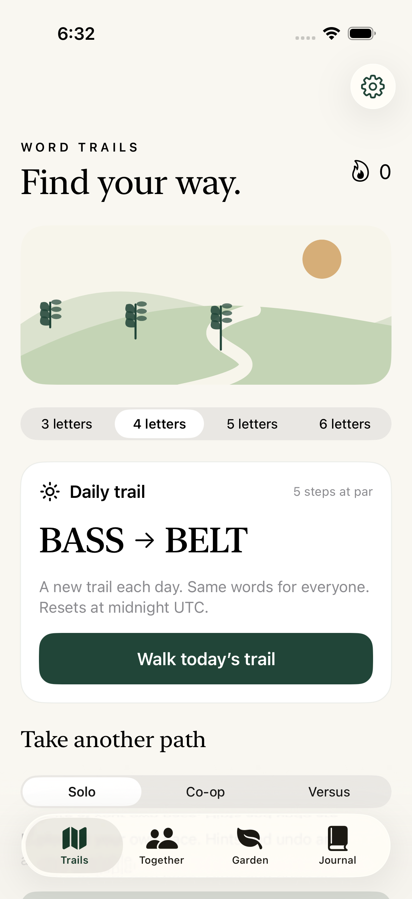
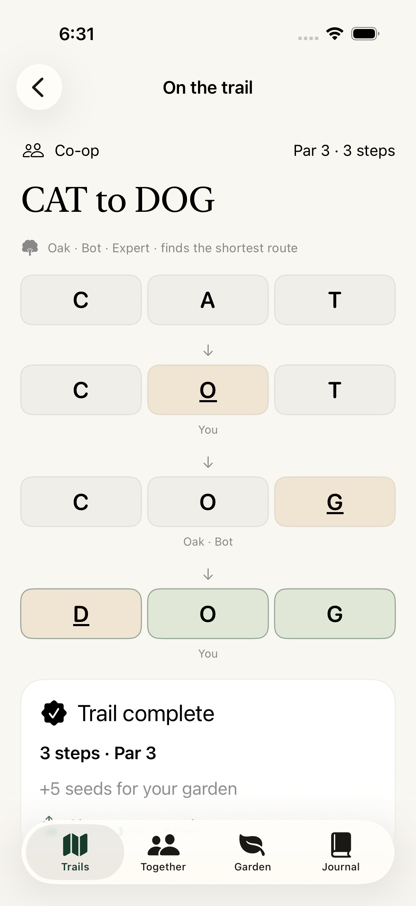

# Word Trails

Native iPhone word ladders, built with SwiftUI for iOS 17 and later. Solo and clearly labelled bot guides work entirely offline. Two-player co-op and asynchronous versus use Apple Game Center; ways2earn.com is not accessed or changed.

Current internal beta: **1.0.0 (4)**. Apple processing is verified `VALID`, and the owner's internal group has testing enabled. The release source is tagged `testflight-1.0.0-4` (commit `74788625561bbae33ac8d753be383ec5b92d8cb9`). All 11 engine tests and four simulator UI tests passed. Two-device Game Center invitations, turn notifications and online outcomes still need real-device beta testing.

 

## Play

Change one letter at a time. Each step must be in the bundled 3–6-letter dictionary. Repeated words are disallowed. Par is computed by breadth-first search over that same dictionary.

- Daily: one deterministic puzzle per length per UTC day. Practice: random verified trails.
- Solo: hints and undo. Bot co-op: alternate one-word moves. Bot versus: compare completed route lengths, ties draw, no hints or undo.
- Pip takes legal detours where possible; Fern takes shorter detours; Oak always uses a shortest path. Every guide is labelled **Bot**. No fake human accounts, network, or external AI service.
- Human co-op: send one word per turn. Human versus: finish your own route, then pass the turn. Routes are revealed after both complete. No hints, undo, or speed advantage. Native Game Center handles invites, matchmaking, forfeiting and notifications.
- Seeds, six collectible plants, nine local badges, streaks, shareable results, saved current trail, and route history. Replays do not farm seeds. Completed co-op trails also grow a shared garden with each human or bot partner.

## Build and verify

On a Mac with Xcode and XcodeGen:

```sh
swift test --parallel
swift Support/make-icon.swift App/Assets.xcassets/AppIcon.appiconset
xcodegen generate
xcodebuild test -project WordTrails.xcodeproj -scheme WordTrails -destination 'platform=iOS Simulator,name=iPhone 17' CODE_SIGNING_ALLOWED=NO
```

The validation workflow selects an available iPhone simulator automatically and exports actual screenshot attachments. A separate release workflow archives, signs, and uploads the exact revision to TestFlight. See `docs/RELEASE.md`.

## Design

Original code-drawn landscape, flat shapes, deliberate spacing, SF Symbols and system typography. No generated raster assets or synthetic profile photos. Light/dark system appearance, Dynamic Type and VoiceOver labels. No ads, analytics, chat, contact upload, paid currency or separate app accounts. Local progress does not sync between devices in version 1.

## Content

The 5,090-word list is authored for the game and intentionally bounded. It is not a complete English dictionary. Browse all accepted words in Field notes. The 242-trail catalog is built offline with `node scripts/generate-trails.mjs` for fast launch; Swift tests independently verify all routes and shortest-path pars. Bots and hints share this versioned dictionary. Steps that would make the destination unreachable are rejected. Do not change the dictionary during a live beta without bumping the multiplayer data version and handling older matches.
