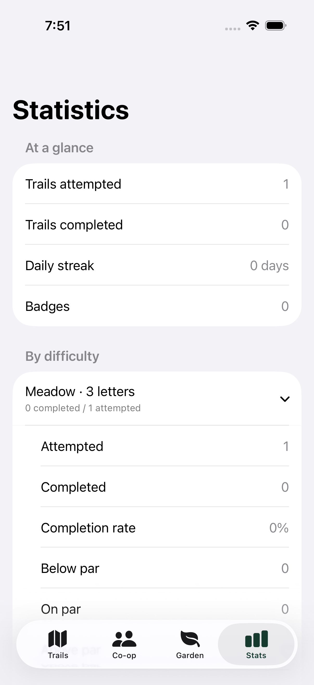
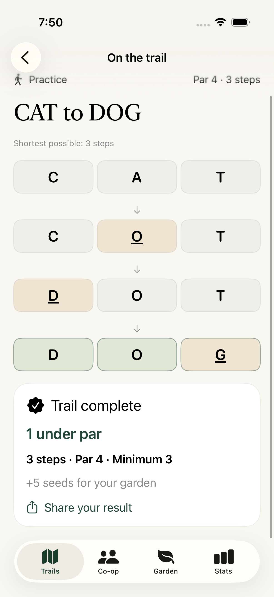

# Word Trails

Native iPhone and iPad word trails for iOS/iPadOS 17 and later. Daily solo play works offline, with optional real-friend co-op through Apple Game Center. No versus mode or bots. The website ways2earn.com is neither accessed nor changed.

Current internal TestFlight beta: **1.3.0 (2)**, Apple processing `VALID`, assigned to Word Trails Internal with status **Testing**. Release source: `testflight-1.3.0-2` (`cdbf32f35a24f4bc5f69cd99a8de88d268165e1b`). All 23 engine tests and five iPhone simulator UI tests passed.

 

## Update 1.4

- Universal iPhone/iPad target; iPad supports portrait, landscape and adaptive window widths.
- Reading widths stay comfortable on larger screens. Wide play screens place the trail alongside the controls; narrow windows and accessibility sizes use a scrolling column.
- Letter tiles retain a sensible size, and result cards and native sharing adapt to iPad.
- A direct badge-collection link in Statistics makes all 24 milestones easier to browse.
- The validation matrix uses full-size iPhone Pro Max and 13-inch iPad Pro simulators. It captures ten store scenes per device, a real gameplay recording and iPad rotation/share checks.
- Store-only sample history is compiled exclusively in Debug and requires both `--ui-test` and `--store-capture`. Real catalogue routes go through normal move validation and reward logic, with isolated temporary saves. Release builds contain no sample-progress switch.
- Store artwork is a code-drawn composition around unaltered simulator captures, with original captures retained.

## Update 1.3

- Completed daily attempts open directly from the daily card; replay is a separate action.
- Searchable completed-trail history is available from Trails and Stats, including older attempts and replays. Saved views retain original routes, scores, par and minimum and never replace the active run, create attempts or award seeds again.
- Minimum-step solutions receive a Shortest possible route acknowledgement on completion, in saved results and on shared cards. Hints or undo do not prevent this route-length recognition; unassisted achievement rules are unchanged.
- Removed the difficulty legend from the bottom of Trails, with a native screenshot and UI regression check.

## Update 1.2

- 37,819 accepted English word forms across the supported 3–6-letter lengths, including inflections and regional spellings. Includes SNARES. A comprehensive spellchecker dictionary, not a claim to contain every English word or proper name.
- 40,000 different trails: 10,000 at each difficulty, over 27 years per difficulty before a pair repeats.
- Every new trail has a familiar-word shortest solution. Breadth-first search across the full dictionary independently confirms no shorter obscure-word route. Minimum steps are at least 4/5/6/7 for 3/4/5/6 letters.
- Par is minimum +1 for 3/4 letters, minimum +2 for 5/6. A difficulty-based target rather than a measured population average.
- Statistics per difficulty and overall: attempts, completions, completion rate, below/on/above par, shortest routes, average steps, average and best result against par. Replays count as new attempts; resuming the same run does not. Historical completions are imported; previously abandoned attempts cannot be reconstructed.
- Daily reminders are opt-in, at a user-selected local time. Repeating iOS local notifications work offline and replace the old scheduled time. System notification settings still apply.
- Existing seeds, plants, streaks and completed routes persist. Historical pars stay unchanged. Unfinished old solo/bot trails migrate to solo and use the expanded dictionary and updated par.

- Familiar hints now consider a familiar continuation even when the current word is unusual. Uncommon continuations are used only when no equally short familiar route remains. The explanation is in Field notes; the hint itself stays concise.
- Sixteen new badges bring the total to 24, with 1,000-trail, 365-day and 365-day-streak milestones. New badges trigger an in-app notice. Historical progress is recognised; distinct-trail badges cannot be farmed with replays.
- Sharing exports an illustrated 1200×1560 result card and a small canonical App Store link. Intermediate route words stay private. The App Store link becomes available at public launch.
- Daily puzzles remain identical worldwide at each difficulty, resetting at midnight UTC. The 1.2 update preserves the 1.1 catalog exactly. Catalog-size copy was removed from Field notes.

## Play and privacy

Change exactly one letter per step; no repeated words. Solo offers hints and undo. Optional co-op alternates one word per turn with a real Game Center partner, without hints or undo. Solo needs no account or internet. Invitations, friends, turn data and turn alerts use Apple Game Center; there is no independent account database or website backend. The co-op pool uses data version 2, while existing version-1 co-op matches retain their original dictionary and rules. Earlier versus matches are hidden.

Rewards include seeds, six collectible plants, 24 badges, daily streaks and shareable results. Seeds are awarded only once per puzzle and mode. Completed friend co-op trails grow shared gardens. Personal progress remains on the device, without cross-device synchronization.

Original vector landscapes, SF Symbols, system typography, Dynamic Type, VoiceOver and dark mode. No generated raster art, ads, analytics SDK, chat, purchases or contact uploads.

## Content provenance and verification

ESDB/SCOWL official release `rel-2026.02.25`, pinned mirror revision `71d7dd07676edb60ade43552e10b41314b7e9287`. Accepted list uses size 85; familiar routes use the size-35 list screened with wordfreq 3.1.1 and editorial inclusions/exclusions. The latter is a practical familiarity proxy, not a guarantee that everyone knows each word. Only 3–6-letter A–Z forms are accepted. Prior accepted words remain available for save compatibility.

Source, extraction settings and hashes are bundled in `dictionary-source.json`; complete notices in `Dictionary-Licence.txt` and `Familiar-Licence.txt`. Reproduce extraction with `scripts/import-dictionary.py` using the official pinned database/tools, then run `python scripts/screen-familiar.py` (wordfreq 3.1.1 required) and `node scripts/generate-trails.mjs`. Catalog generation never silently relaxes the difficulty or familiar-route requirements.

On a Mac with Xcode and XcodeGen:

```sh
swift test -c release --parallel
swift Support/make-icon.swift App/Assets.xcassets/AppIcon.appiconset
xcodegen generate
xcodebuild test -project WordTrails.xcodeproj -scheme WordTrails -destination 'platform=iOS Simulator,name=iPhone 17' CODE_SIGNING_ALLOWED=NO
```

Engine tests verify all 40,000 minima independently, legal familiar witnesses, dictionary regressions, statistics, migration, rewards, co-op versioning and reminder times. Simulator UI tests cover solo completion, under-par scoring, statistics, reminder settings, onboarding, dark mode and large text. Two-device Game Center turns and real-device notification delivery require beta testing.

The validation workflow exports native simulator screenshot attachments. The isolated signing workflow archives the exact source revision and checks the bundle/version/build before TestFlight upload. See `docs/RELEASE.md` for release setup and earlier shipping history.

## Public builds

The repository is public. Validation and TestFlight signing use standard GitHub-hosted runners directly in WordTrails-iOS. The five signing secrets are encrypted GitHub Actions repository secrets and are referenced only by the manual release workflow. No signing key is committed. The approved one-run encrypted migration is complete; its temporary runner, local files and migration job were removed. Future Word Trails builds are independent of the earlier shared signing setup.
